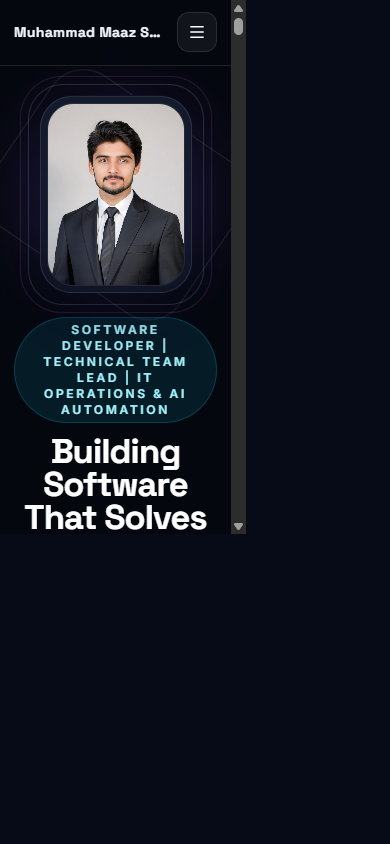
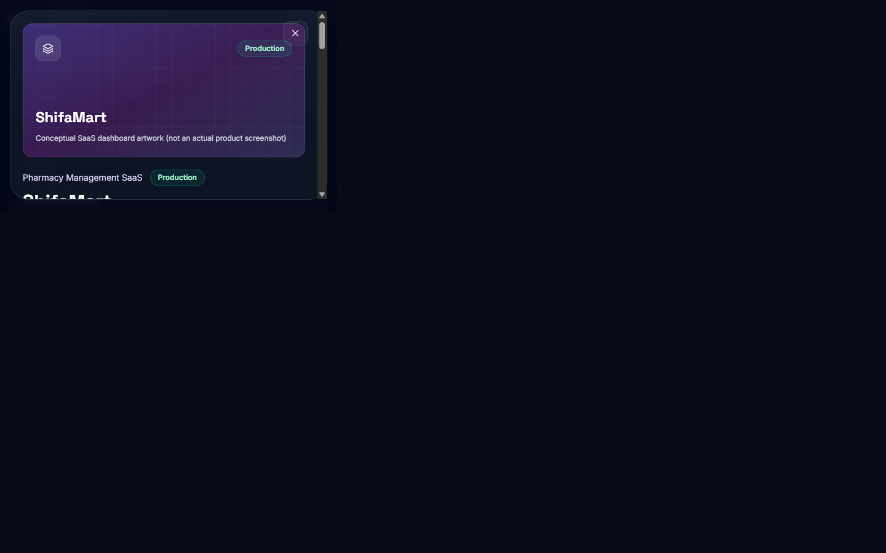

<div align="center">

# Muhammad Maaz Shahid — Portfolio V2

**Software Developer | Technical Team Lead | IT Operations & AI Automation**

[](https://portfolio-4bdf2.web.app/)
[](https://github.com/maaz-shahid-dev)
[](https://www.linkedin.com/in/maaz-shahid-5457043ba/)
[](./public/Muhammad-Maaz-Shahid-CV.pdf)

<br/>

[](https://react.dev/)
[](https://www.typescriptlang.org/)
[](https://vite.dev/)
[](https://tailwindcss.com/)
[](https://threejs.org/)
[](https://r3f.docs.pmnd.rs/)
[](https://gsap.com/)
[](https://motion.dev/)
[](https://firebase.google.com/products/hosting)

<br/>

**Building Software That Solves Real-World Problems.**

A premium, responsive 3D developer portfolio showcasing verified professional experience, international-ready positioning, and case-study project presentations.

[Live Website](https://portfolio-4bdf2.web.app/) · [Download CV](./public/Muhammad-Maaz-Shahid-CV.pdf) · [Production Launch Report](./PORTFOLIO_V2_PRODUCTION_LAUNCH_REPORT.md) · [Final QA Report](./PORTFOLIO_V2_FINAL_QA_REPORT.md)

</div>

---

## Overview

**Portfolio V2** is a production-deployed, Vite-based React application presenting Muhammad Maaz Shahid’s profile for **international remote jobs, relocation opportunities, and freelance/consulting collaborations**. It combines a cinematic interactive 3D hero with clear, recruiter-friendly sections for expertise, project case studies, verified experience, services, resume, and contact.

- **Live:** [https://portfolio-4bdf2.web.app/](https://portfolio-4bdf2.web.app/)
- **Canonical hosting:** Firebase Hosting (`portfolio-4bdf2`, SPA rewrite to `dist/index.html`)
- **Availability:** Based in Pakistan · Open to remote opportunities, international relocation, and freelance collaborations

## Screenshots

<table>
  <tr>
    <td align="center"><strong>Desktop — Home / Hero</strong><br/></td>
    <td align="center"><strong>Mobile — Home</strong><br/></td>
  </tr>
  <tr>
    <td align="center"><strong>3D Hero Experience</strong><br/></td>
    <td align="center"><strong>Featured Projects & Case Study</strong><br/></td>
  </tr>
  <tr>
    <td align="center"><strong>Expertise</strong><br/></td>
    <td align="center"><strong>Professional Experience</strong><br/></td>
  </tr>
  <tr>
    <td align="center"><strong>Resume</strong><br/></td>
    <td align="center"><strong>Contact</strong><br/></td>
  </tr>
</table>

> Additional QA captures (reduced-motion, mobile menu, services, projects grid, etc.) are available in [`qa-artifacts/screenshots/`](./qa-artifacts/screenshots/).

## Key features

- **Interactive 3D hero** with React Three Fiber/Three.js, lazy loading, graceful fallback handling, and reduced-motion-aware behavior
- **International-ready IA & conversion paths:** Hire Me (remote/full-time), Discuss Relocation, and Start a Project (freelance/SaaS/mobile/backend/automation), with intent-aware contact flow
- **Project case studies** using a reusable data model (overview, status, problem, solution, responsibilities, stack, features, architecture, challenges/outcomes where documented, links, and clearly labeled visuals)
- **Verified professional timeline** with CV-provided responsibilities and clear distinction between hands-on development experience and formal employment periods
- **Expertise & services** covering mobile, web/SaaS, backend/API integration, databases, cloud/deployment, AI automation, technical coordination, and SEO/digital technologies
- **Resume section** with View/Download CV, summary, competencies, education, languages, and experience highlights
- **Validated mailto contact flow** (client-side validation, intent categories, prepared draft; no false “sent” confirmation) plus verified direct links (email, LinkedIn, GitHub, WhatsApp)
- **SEO & discoverability:** metadata, Open Graph/Twitter tags, JSON-LD Person schema, canonical URL, `robots.txt`, and `sitemap.xml`
- **Responsive, accessible UI:** semantic structure, keyboard-friendly interactions, mobile navigation, and performance-conscious loading/code splitting

## Featured projects (verified highlights)

| Project | Type / Status | Highlights | Links |
|---|---|---|---|
| **ShifaMart** | Pharmacy Management SaaS · Production | Publicly presented pharmacy operations platform; documented capabilities include inventory, sales/POS, reporting, multi-branch workflows, role-based access considerations, and PostgreSQL-backed/cloud SaaS workflows (details limited to verified/public information) | [Website](https://www.shifamart.app/) |
| **Islamic Life** | Flutter Android App · Production | Published mobile app with Islamic utility features (e.g. Quran access, prayer times, Qibla, duas) | [Google Play](https://play.google.com/store/apps/details?id=com.maazshahidapps.islamiclife) |
| **SpendWise** | Flutter Expense Tracker · Production | Published expense/budget tracking app (tracking, budgets, categories, reports/views; offline-capable patterns as documented) | [Google Play](https://play.google.com/store/apps/details?id=com.maazshahidapps.spendwiseapp) |
| **Portfolio V2** | 3D Developer Portfolio · Production | This repository/live site: international-ready professional portfolio with 3D hero, case studies, resume/contact pathways, and SEO | [Live](https://portfolio-4bdf2.web.app/) · [Repo](https://github.com/maaz-shahid-dev/portfolio-v2) |
| **Eprofly** | Social & Communication App · Prototype | Verified contribution areas: Flutter, messaging, notifications, multimedia, Firebase, Node.js, MongoDB (no commercial launch or active-user claims) | — |
| **AI SEO & Keyword Research Automation** | AI/Workflow Automation · Prototype | Documented local workflow using n8n, Docker, WSL2, Ollama/local LLMs, webhooks, structured JSON responses, and duplicate-prevention/data-table handling | — |
| **Road Rescue** | Location-based Service App · Concept | Clearly labeled concept exploration (not a launched/production system) | — |

> Project visuals in-app are labeled when conceptual/workflow-based; no fabricated metrics, user counts, revenue, testimonials, or launch claims.

## Tech stack

- **Frontend:** React 19, TypeScript, Vite
- **Styling/UI:** Tailwind CSS v4
- **3D & Graphics:** Three.js, React Three Fiber, Drei
- **Animation:** GSAP, Motion
- **Quality:** oxlint
- **Hosting:** Firebase Hosting (SPA)

## Project structure (high level)

```text
src/
  components/        # Layout, hero/3D, and section UI
  data/              # Verified profile, projects, experience, services, contact intent models
  hooks/             # Reusable hooks (e.g. reduced motion / media queries)
public/              # Static assets, CV, robots.txt, sitemap.xml
qa-artifacts/        # QA and production screenshot evidence
```

## Local development

### Prerequisites
- Node.js
- npm

### Install
```bash
npm install
```

### Run locally
```bash
npm run dev
```
Vite will print the local development URL (typically `http://localhost:5173`).

### Lint
```bash
npm run lint
```

### Build
```bash
npm run build
```
Runs TypeScript checks (`tsc -b`) and produces the production bundle in `dist/`.

### Preview production build
```bash
npm run preview
```

## Documentation & links

- **Live site:** [https://portfolio-4bdf2.web.app/](https://portfolio-4bdf2.web.app/)
- **CV (PDF):** [`public/Muhammad-Maaz-Shahid-CV.pdf`](./public/Muhammad-Maaz-Shahid-CV.pdf)
- **Production launch report:** [`PORTFOLIO_V2_PRODUCTION_LAUNCH_REPORT.md`](./PORTFOLIO_V2_PRODUCTION_LAUNCH_REPORT.md)
- **Final QA report:** [`PORTFOLIO_V2_FINAL_QA_REPORT.md`](./PORTFOLIO_V2_FINAL_QA_REPORT.md)
- **International upgrade report:** [`PORTFOLIO_V2_INTERNATIONAL_UPGRADE_REPORT.md`](./PORTFOLIO_V2_INTERNATIONAL_UPGRADE_REPORT.md)

## Notes

- Portfolio content is maintained in `src/data/` to keep information consistent and verifiable.
- The contact form opens a prepared email draft via `mailto:` (no backend submission service configured).
- Firebase Hosting is configured for project `portfolio-4bdf2` with SPA rewrites; production deployment is controlled and Hosting-only when performed.

---

<div align="center">

**Open to international remote roles, relocation opportunities, and freelance collaborations.**

[LinkedIn](https://www.linkedin.com/in/maaz-shahid-5457043ba/) · [GitHub](https://github.com/maaz-shahid-dev) · [WhatsApp](https://wa.me/923237843084) · [Email](mailto:m.maazshahid2003@gmail.com)

</div>


